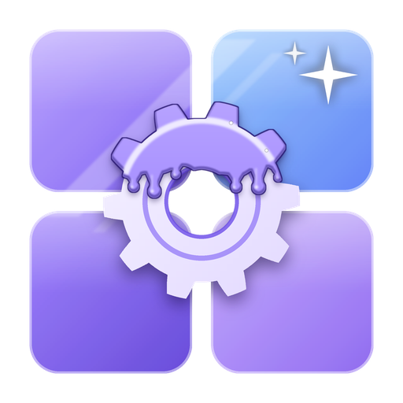

<p align="center"></p>
<h1 align="center">Glazed Menu</h1>
<p align="center"><b>A glassy mod list and config screens for every mod.</b><br>
Client side · Fabric, NeoForge &amp; Forge · Minecraft 1.20 – 26.3</p>
<p align="center">
  <a href="https://modrinth.com/mod/glazedmenu"></a>
  <a href="https://www.curseforge.com/minecraft/mc-mods/glazed-menu"></a>
  <a href="https://ixdarklord.github.io/GlazedMenu/"></a>
</p>
<p align="center">
  
  
  
  
  <a href="https://discord.gg/ZapGEPqm2V"></a>
</p>
<hr>

Glazed Menu replaces Mod Menu's, NeoForge's and Forge's mod lists with its own, and gives the configs of almost any mod a
clean, themed screen. It needs no other mod.

## Download
- [Modrinth](https://modrinth.com/mod/glazedmenu)
- [CurseForge](https://www.curseforge.com/minecraft/mc-mods/glazed-menu)

## Documentation
Guides for players and mod authors, the Java API and the changelog are at
[ixdarklord.github.io/GlazedMenu](https://ixdarklord.github.io/GlazedMenu/).

## The mod list
- **Grid or list view**, filters for **All**, **With Settings** and **Libraries**, search, and sorting A–Z, Z–A or by
  the most recently installed.
- **Favorites and hidden mods**: star a mod to list it first (and under **Favorites**), or hide it from the list (it
  stays under **Hidden**).
- **Groups**: mods that bundle others (like Fabric API and its modules) open and close as one group.
- **Each mod in its own colors**, taken from its logo; a details pane with its description, authors, links, what it
  needs and what it bundles.
- **Update notices**: mods with a newer version get a mark, and the details pane shows the new version. They come
  from the update files mods publish, and for the other mods from Modrinth, by the hashes of their files (optional).
  A notice can be ignored until the next version.
- A button to **open the mods folder**, and the game's own **options** as Minecraft's settings.

## The config screens
One look for every mod's settings: a sidebar of categories, search, undo / redo, reset, presets, validation, restart
notices, list editing and a color picker. Configs from:
- **CoolCatLib: Core** (with its themes),
- **NeoForge** (`ModConfigSpec`), and on Fabric through **Forge Config API Port** (also Forge's `ForgeConfigSpec`),
- **Cloth Config** (AutoConfig), **YACL**, **MidnightLib**,
- **MezzConfig** (JEI) and **FTB Library** (FTB mods), each optional in Glazed Menu's settings,
- **Minecraft's own options** (optional),
- and a link to the screen of any mod with its own.

**Search every mod's settings at once**: the search on the Mod Configs screen (or `/glazedmenu search`) lists the
matching settings of every mod with their editors, to change right there.

**See what you've changed**: Changed, on the same screen (or `/glazedmenu changed`), lists every setting that isn't at
its default, to edit, reset, or copy as text for a bug report.

**Profiles**: save the settings listed (across any mods) under a name, and switch between such sets from the Profiles
button or with `/glazedmenu profile <name>`. A profile sets the settings it holds and leaves the others as they are.

## The game's options
The game's **Options** screen opens with a ribbon of tabs across the top: **Quick** (the options most reached for,
and every option you changed), each category of its options in its own color (Video, Controls, Mouse, Chat, Music &
Sounds, Accessibility...), and **More** (the controls, the language, the resource packs, the skin, and the game's own
screen). Under it, the chosen tab's settings are cards in two columns, changed right there. Optional in Glazed Menu's
settings.

The **Language** screen opens in the same look, with a search by a language's name, region or code. So does the
**packs** screen (resource packs, and a new world's data packs): the packs in use as a stack you drag to reorder,
beside the packs to choose from as tiles, with a search and a warning on packs made for another version.

**Game rules**, when making a world, open in Glazed Menu's config screen too: their categories in the sidebar, with
search, reset and undo, and the rules you changed marked.

With **Sodium** or **Iris** installed, the Video tab leads with cards opening Sodium's video settings and the shader
packs; their own video screens are left as they are. Iris's list of **shader packs** opens in Glazed Menu's look
(shaders on or off, the chosen pack, and the packs as tiles), with each pack's own settings still in Iris's screen.

## The title, pause, singleplayer, multiplayer, advancements and statistics screens
The **title** screen keeps the panorama open and adds **Continue** (the world you played last, opened at a click).
Pick its layout in Glazed Menu's settings: **Shelf** (the logo at the top, and cards along the bottom over a bar of
the rest) or **Sidebar** (the logo and the menu as a list down the left side). The first time the game runs
with Glazed Menu, a **welcome** over it points to the settings that turn each replaced screen back into the game's own.

**Create World** opens with the game's three tabs as a ribbon, the game mode as cards, and what the world will be made
with beside them; the game's own screen is a button away. **Edit World** groups the world's files, backups and
upkeep as cards, with the world itself beside them. Adding or editing a **server** shows the server as it answers
at the address you type, before you save it.

While a world or a server is **loading** (and while one is read, made or saved), the screen shows the world's icon
inside a ring cut into one piece for each step, its name and the step under way, and the steps named and timed
under it, over the game's panorama.

The **pause** screen opens in Glazed Menu's look: Back to Game, the screens a pause leads to (advancements, statistics,
the options, the mods, opening to LAN, feedback) each in its own color, a few **quick settings** applied as you change
them, and Save and Quit set apart from the rest. Pick its layout in Glazed Menu's settings: **Dock** (a bar across the
top and tiles along the bottom, the world open between them), **Cards** (a frame in the middle) or **Sidebar** (a list
down the left side, with the world's day, your position and the biome beside it).

The **singleplayer** screen lists your worlds with a search and sorting, and shows the chosen world's details beside
the list: its picture, game mode and difficulty, its version, its size on disk, and what stands in the way of playing
it. The **multiplayer** screen does the same for servers: whether each answers and how fast, its version, its players
and its message, with the games on your network under a heading of their own. A star makes a world or a server a
**favorite**, listed first.

The **advancements** screen lists each tab's advancements under the ones they come after, with the chosen one's steps
ticked off beside the list, filters for the ones done or under way, and a search across every tab; the game's tree is
a button away. The **statistics** screen shows General, Blocks, Items and Mobs as tables you sort by clicking a
column, under cards for the time played, the distance traveled, mob kills and deaths.

Each of these is optional in Glazed Menu's settings.

## The key binds
The game's key binds screen in the same look: categories in a sidebar, with **All**, **Conflicts**, **Changed** and
**Unbound**, and each key bind in conflict marked with what else uses its key. Optional in Glazed Menu's settings.
- **Search** by name, key, category or mod: `@mod` lists one mod's key binds, `=key` the ones on exactly that key, and
  **By Key** searches for the key you press next.
- **Sort** by category, name or key.
- **Reset** and **Unbind** act on the key binds shown: the chosen category or filter, or what the search found.

The game's **Controls** screen opens as a **map of the keyboard** (and of the mouse): keys are tinted where something
is bound and red where key binds are in conflict. Pick a key to see what's bound to it and rebind it, by pressing a key
or clicking one on the map; the control settings sit beside, and List opens every key bind as a list.

## Looks
Dark and light modes, color schemes (Glazed, Classic, Ocean, Forest, Ember, Rose, Slate), panel opacity, background
effects and fading page transitions, all in Glazed Menu's settings.

## For mod authors
Glazed Menu works with your mod as it is. These are optional extras, all read from files, with no code dependency on
Glazed Menu.

### List your mod under Libraries
**Fabric**, in `fabric.mod.json`:
```json
"custom": {
  "glazedmenu": { "library": true }
}
```

**NeoForge and Forge**, in `neoforge.mods.toml` or `mods.toml`:
```toml
[modproperties.yourmodid]
library = true
```

### Update notices
**NeoForge and Forge** use your mod's usual `updateJSONURL`, so there is nothing to add.

**Fabric**: point Glazed Menu at an update file in `fabric.mod.json`:
```json
"custom": {
  "glazedmenu": { "update_json": "https://example.com/updates/yourmodid.json" }
}
```
The file uses the Forge and NeoForge update JSON format. Glazed Menu takes the `<minecraft>-recommended` version for
the running game (or `<minecraft>-latest`), and shows a notice when it's newer than the installed one:
```json
{
  "homepage": "https://modrinth.com/mod/yourmod",
  "promos": {
    "1.21.1-recommended": "1.2.0",
    "1.21.1-latest": "1.3.0-beta"
  }
}
```

### Your mod's look in the config screens
Ship `assets/<modid>/glazedmenu/config_theme.json` in your mod, or in a resource pack to theme any mod. Every field is
optional; colors are `"#RRGGBB"` or `"#AARRGGBB"`:
```json
{
  "base": "tinted",
  "colors": { "accent": "#E86BA8" },
  "light_base": "tinted",
  "icon": "yourmodid:textures/gui/config_icon.png",
  "background": "yourmodid:textures/gui/config_background.png",
  "background_mode": "cover",
  "background_opacity": 0.6
}
```
- `base` / `light_base`: `tinted` (shaded with your accent), `dark` or `light`, for the dark and light modes.
- `colors` / `light_colors`: any of `accent`, `backdrop`, `panel`, `panel_border`, `bar`, `popup`, `row_hover`, `field`,
  `field_border`, `button`, `button_hover`, `button_disabled`, `toggle_off`, `knob`, `text`, `text_dim`, `text_muted`,
  `modified`, `error`, `success`, `warning`.
- `background_mode`: `stretch`, `cover` or `tile` (with `tile_size`). Also `texture_opacity`, `background_in_world`,
  `popup_sprite` and `effects`.

### Config card artwork
Each of your configs gets a card in Glazed Menu's config screens. To use your own artwork instead of the built-in one
for its kind (client, server, ...), ship `assets/<modid>/textures/gui/config/cards/<config name>.png`. The image is
portrait (about 1:1.3), for example 512×672.

### Your own config screen
If your mod has its own config screen (Mod Menu's `ModMenuApi`, NeoForge's `IConfigScreenFactory`, Forge's
`ConfigScreenFactory`), its Settings button opens it.

## Versions
Each Minecraft version lives on its own branch: `main` (26.1 – 26.1.2), `26.2`, `26.3`, `1.21-1.21.1` (also Forge) and
`1.20-1.20.1` (Fabric and Forge).

## Building
`./gradlew build`. CoolCatLib: Core and Canvas (optional integrations) are compiled against from Maven, including
Maven Local while developing.

## License
[MPL-2.0](LICENSE)
